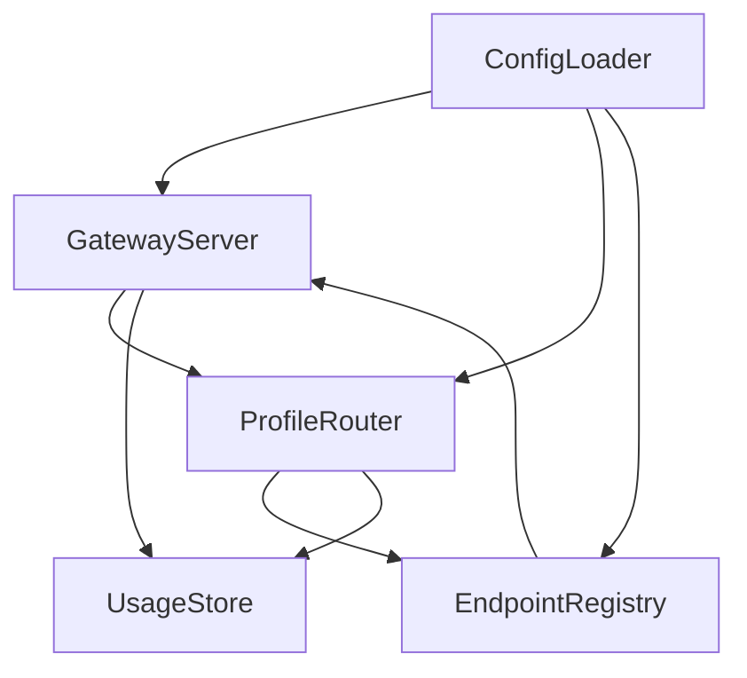

# Offline Local Model Switchboard CLI

A command-line tool that starts a self-hosted gateway on a laptop or on-premises server, registers locally running model endpoints behind one OpenAI-compatible address, and switches routing profiles between a small local model for drafting and a larger local model for review without changing client configuration, while logging all usage locally so token counts and costs stay visible even when no cloud provider is reachable.

Built from the starred repo **QuantumNous/new-api** — new-api's self-hosted Go gateway, its single OpenAI-compatible API surface, and its model routing and local usage tracking

## Why this package exists

Long agentic coding sessions drift: an assistant asked to build the whole thing at once invents APIs, skips tests, or quietly swaps in mock data. For this project the sharpest drift risk is invented flags and exit codes: a command surface guessed mid-build breaks every script written against it. The package pins the command contract in one spec before any command is implemented. This package counters that with one spec of record (`PROJECT-SPEC.yaml`), global rules the coding agent loads once (`AGENTS.md`, `guardrails/GLOBAL-PROTOCOL.md`), and eight sequentially gated phases, each with a test requirement and pass/fail criteria a human verifies before the next phase starts.

## Tech stack

| Layer | Choice | Version | Role |
|---|---|---|---|
| Language and runtime for the CLI and the gateway server | Go | 1 | Language and runtime for the CLI and the gateway server |
| Command tree, subcommands, flags, and help output for the CLI | Cobra | 1 | Command tree, subcommands, flags, and help output for the CLI |
| Configuration file, environment variable, and flag precedence handling | Viper | 1 | Configuration file, environment variable, and flag precedence handling |
| Embedded local database for usage and token-count records | SQLite | 3 | Embedded local database for usage and token-count records |

## Architecture



## Phase dependencies

```mermaid
flowchart LR
  P1["Phase 1: Foundation"]
  P2["Phase 2: Minimal end-to-end vertical slice"]
  P3["Phase 3: Endpoint registry and health checks"]
  P4["Phase 4: Routing profiles"]
  P5["Phase 5: Local usage logging"]
  P6["Phase 6: Integration"]
  P7["Phase 7: Hardening"]
  P8["Phase 8: Release verification and packaging"]
  P1 --> P2
  P2 --> P3
  P3 --> P4
  P4 --> P5
  P5 --> P6
  P6 --> P7
  P7 --> P8
```



Phases with no dependency edge between them can be reviewed independently, but they are still executed sequentially under the locking rule in `AGENTS.md`.

## How to use this with a coding assistant

1. Load `AGENTS.md` as the assistant's persistent rules file (`.cursorrules`, `.windsurfrules`, `CLAUDE.md`, or the equivalent for your tool).
2. Load `ARCHITECTURE.md` and the reference document listed in the folder tree below as standing context.
3. Feed the phase files in `docs/phases/` one at a time, in order, starting with `phase-01`.
4. After each phase, verify its Pass / Fail Criteria table yourself before continuing. Do not let the agent self-certify.
5. Never let the agent combine phases or skip ahead to save time; sequential locking is the point of the package.

## Folder tree

```
offline-local-model-switchboard-cli/PROJECT-SPEC.yaml
offline-local-model-switchboard-cli/README.md
offline-local-model-switchboard-cli/AGENTS.md
offline-local-model-switchboard-cli/ARCHITECTURE.md
offline-local-model-switchboard-cli/guardrails/GLOBAL-PROTOCOL.md
offline-local-model-switchboard-cli/tests-plan/TDD-STRATEGY.md
offline-local-model-switchboard-cli/contracts/CLI-REFERENCE.md
offline-local-model-switchboard-cli/docs/phases/phase-01-foundation.md
offline-local-model-switchboard-cli/docs/phases/phase-02-vertical-slice.md
offline-local-model-switchboard-cli/docs/phases/phase-03-endpoint-registry.md
offline-local-model-switchboard-cli/docs/phases/phase-04-routing-profiles.md
offline-local-model-switchboard-cli/docs/phases/phase-05-usage-logging.md
offline-local-model-switchboard-cli/docs/phases/phase-06-integration.md
offline-local-model-switchboard-cli/docs/phases/phase-07-hardening.md
offline-local-model-switchboard-cli/docs/phases/phase-08-release-verification.md
```

## Notes on scope

The following are permanently out of scope for this project, restated from `PROJECT-SPEC.yaml`:

- Hosting or running model inference itself; the tool only fronts endpoints that already run locally
- Proxying to cloud model providers or performing cloud billing and metering
- Providing a graphical user interface or web dashboard
- Fine-tuning, training, or evaluating models
- Multi-user authentication, single sign-on, or team access control

If a future phase or request pushes past this boundary, stop for human review rather than proceeding.
